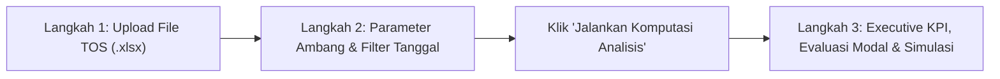

# 🚢 CACA - Cycle Analyst & Cargo Acceleration
### Dashboard Analisis Rekonstruksi Dual Cycle & Twin Lift Kontainer
**PT Pelindo Terminal Teluk Lamong (TTL) — Proyek Inovasi Kelompok Magang**


---

## 📌 1. Tujuan & Latar Belakang Bisnis

### Latar Belakang Operasional
**PT Terminal Teluk Lamong (TTL)** merupakan terminal ramah lingkungan (*Green Port*) semi-otomatis berstandar internasional pertama di Indonesia. Dalam kegiatan bongkar muat (*discharge* dan *load*) peti kemas, produktivitas dermaga diukur dari kecepatan pergerakan kapal (*turnaround time*) dan efisiensi lalu lintas darat antara dermaga (*quay*) dan lapangan penumpukan (*container yard / CY*).

Tiga pilar utama pengungkit produktivitas dan efisiensi terminal adalah:
1. **Dual Cycle (Two-Way Load)**: Mekanisme operasional di mana armada truk terminal (*Combined Terminal Tractor / CTT*) melakukan pengangkutan peti kemas dua arah dalam satu siklus perjalanan bolak-balik: membawa kontainer bongkar (*DISC*) dari dermaga ke lapangan, lalu langsung memuat kontainer muat (*LOAD*) dari lapangan kembali ke dermaga tanpa perjalanan kosong (*empty truck trip*).
2. **Twin Lift**: Kemampuan spreader *Ship-to-Shore* (STS) Crane untuk mengangkat sekaligus dua kontainer ukuran 20 kaki (*twenty-foot*) dalam satu kali gerakan angkat (*single lifting movement*), baik pada saat bongkar maupun muat kapal.
3. **Combo Truck**: Kemampuan chasis truk terminal untuk mengangkut dua unit kontainer 20ft sekaligus (2x 20ft) dalam satu ritase perjalanan fisik.

### Masalah yang Dihadapi (Sebelum Dashboard CACA)
Sebelum sistem ini diimplementasikan, evaluasi rasio kualifikasi Dual Cycle dan utilisasi Twin Lift di Pelindo TTL dihitung secara semi-manual menggunakan **Macro Excel VBA**. Pendekatan ini memiliki sejumlah kelemahan krusial:
- **Keterbatasan Kinerja & Skalabilitas**: Macro VBA sering mengalami *freeze*, *not responding*, atau *crash* saat memproses data log operasional TOS (*Terminal Operating System*) berukuran besar (puluhan hingga ratusan ribu baris).
- **Ketiadaan Visualisasi Eksekutif**: Hasil akhir berupa lembaran angka spreadsheet statis tanpa diagram interaktif, perbandingan tren bulanan, evaluasi per shift kerja, maupun performa crane individual.
- **Bias Perhitungan Rasio**: Penghitungan persentase Combo dan Twin Lift sebelumnya sering kali dibagi terhadap *seluruh kontainer* (termasuk ukuran 40ft/45ft yang secara fisik tidak pernah eligible), menghasilkan angka persentase yang bias rendah palsu.
- **Kurangnya Analisis Peluang Efisiensi**: Tidak tersedianya identifikasi terhadap ritase yang "hampir" menjadi Dual Cycle atau Combo (tertunda karena selisih beberapa menit di atas ambang batas).

### Tujuan Dashboard CACA
Aplikasi **CACA** dibangun untuk:
1. **Mengotomatisasi Rekonstruksi Siklus**: Menggantikan macro VBA dengan mesin komputasi Python berkecepatan tinggi yang 100% konsisten, tervektorisasi, dan terverifikasi secara permanen.
2. **Menyajikan Executive Dashboard Interaktif**: Mengadopsi estetika *Maritime Dark Glassmorphism* yang elegan, responsif, dan siap digunakan oleh jajaran manajemen, *planner*, maupun *control room*.
3. **Menganalisis Peluang Efisiensi (Potensi Dual Cycle & Potensi Combo)**: Mengidentifikasi antrean armada yang memiliki jeda waktu sedikit melebihi ambang batas resmi untuk dievaluasi oleh tim operasional lapangan.
4. **Mensimulasikan Dampak BBM & Finansial Nyata**: Memproyeksikan penghematan ritase truk kosong, konsumsi bahan bakar solar industri (Liter), penghematan biaya operasional (Rupiah), serta reduksi emisi karbon untuk mendukung komitmen *Green Port*.

---

## 🚀 2. Cara Pengoperasian Dashboard (Alur 3 Langkah)

Dashboard dirancang dengan alur kerja 3 langkah linier yang intuitif dan cepat:



### **Langkah 1: Upload File Data Operasional**
1. Pada kartu **Langkah 1**, klik tombol **"Upload File"** atau tarik file data Anda (*drag-and-drop*).
2. Format file yang didukung adalah spreadsheet Excel (`.xlsx`) hasil ekspor log TOS / VBS hingga ukuran 200 MB.
3. Mesin parser mendeteksi seluruh sheet secara otomatis dan menampilkan metadata ukuran file.

### **Langkah 2: Konfigurasi Parameter Ambang Batas & Filter Periode**
1. **Pilih Lembar Data (Sheet)**: Pilih sheet yang memuat data pergerakan kontainer.
2. **Filter Periode / Rentang Tanggal Operasional**:
   - Tersedia pilihan: `Semua Periode (Penuh)`, `Per Hari (Harian)`, `Per Minggu (Mingguan)`, `Per Bulan (Bulanan)`, dan `Rentang Tanggal Bebas`.
   - Menggunakan datepicker interaktif dengan pembatasan rentang aman `[min_date, max_date]`.
3. **Parameter Ambang Batas Resmi (Thresholds)**:
   - **Ambang Batas Combo (menit)** *(Default: 3 menit)*: Toleransi selisih waktu maksimum dua kontainer 20ft untuk diakui sebagai muatan Combo (2x 20ft) dalam 1 truk.
   - **Ambang Batas Dual Cycle (menit)** *(Default: 30 menit)*: Toleransi selisih waktu antara akhir aktivitas pertama dan awal aktivitas kedua pada truk yang sama untuk diakui sebagai siklus ganda.
   - **Ambang Batas Twinlift (menit)** *(Default: 1 menit)*: Selisih waktu angkat dermaga (`DISC_LOAD_TS`) antar kontainer 20ft pada crane kade internasional yang sama.
4. **Batas Toleransi Evaluasi Potensi**:
   - **Maksimal Toleransi Potensi Dual Cycle (menit)** *(Default: 180 menit / 3 jam)*: Batas atas jeda waktu untuk memetakan peluang Dual Cycle tertunda dari data Non-Dual.
   - **Maksimal Toleransi Potensi Combo (menit)** *(Default: 30 menit)*: Batas atas jeda waktu untuk memetakan peluang Combo tertunda dari data Single 20ft.
5. **Eksekusi Analisis**:
   - Klik **"Jalankan Komputasi Analisis"**. Sistem akan memproses puluhan ribu baris dalam hitungan detik dengan animasi *Hybrid Loading Bar* dan melakukan *smooth auto-scroll* langsung ke Langkah 3.

### **Langkah 3: Executive KPI, Evaluasi Modal & Simulasi Interaktif**
Hasil analisis disajikan ke dalam Mini Card KPI Interaktif dan 4 Tab Analitik:

#### **Mini Card KPI Section (Header Langkah 3)**
- **Total Petikemas**: Total keseluruhan kontainer (20ft, 40ft, 45ft). Dapat diklik untuk membuka rincian *Container LOAD* dan *Container DISC*.
- **Total Ritase**: Jumlah seluruh pergerakan ritase truk operasional.
- **Dual Cycle**: Jumlah ritase truk yang berhasil membawa muatan dua arah.
- **Non Dual**: Jumlah ritase truk yang hanya membawa muatan satu arah (*Single Cycle*).
- **% Dual Cycle**: Rasio persentase ritase Dual Cycle terhadap total ritase operasional.

#### **Tab 1: Dual Cycle**
- **Donut Chart Dual Cycle vs Non Dual**: Menampilkan proporsi ketercapaian Dual Cycle.
- **3 Tombol Modal Rincian Cepat**:
  - `🔍 Rincian Dual Cycle`: Menampilkan tabel transparan waktu `Mulai DISC`, `Selesai DISC`, `Mulai LOAD`, `Selesai LOAD`, nilai `Gap`, serta **deteksi baris anomali berlatar merah halus** untuk jeda waktu transisi $< 10\text{ menit}$.
  - `🔍 Rincian Non Dual`: Menampilkan rincian ritase muatan satu arah lengkap dengan durasi pergerakannya.
  - `💡 Potensi Dual Cycle`: Mengidentifikasi pasangan ritase Non-Dual yang berurutan bergantian (`DISC ➔ LOAD` atau `LOAD ➔ DISC`) dengan jeda antara $30\text{ mnt} < \text{Gap} \le 180\text{ mnt}$ sebagai sasaran optimasi operasional.
- **Breakdown Bulanan Dual Cycle vs Non Dual**: Grafik tren bulanan dilengkapi input **Target Optimal (%)** dan sakelar garis target yang diisolasi dengan `@st.fragment` (perubahan angka target tidak mereload halaman).
- **Breakdown Waktu Operasional (3 Shift Kerja)**: Analisis performa per shift standar pelabuhan:
  - **Shift 1**: `00.00 – 08.00`
  - **Shift 2**: `08.00 – 16.00`
  - **Shift 3**: `16.00 – 00.00`

#### **Tab 2: Twinlift & Combo**
- **Filter Lingkup Evaluasi Twinlift (Radio Button Scope)**:
  - `Internasional` *(Default)*: Mengisolasi evaluasi khusus kade internasional (Quay Crane ID berakhiran `"I"`: `01I` – `05I`) dengan rasio Twinlift riil $\approx 67\%$.
  - `Domestik & Internasional`: Mengevaluasi seluruh kade terminal.
- **Donut Chart Twinlift vs Bukan Twinlift** (berbasis kontainer 20ft) bersanding dengan tombol `🔍 Rincian Twinlift` dan `🔍 Rincian Bukan Twinlift` dalam format tabel 1 baris horizontal menyamping.
- **Donut Chart Combo vs Single** (berbasis kontainer 20ft) bersanding dengan tombol `🔍 Rincian Combo`, `🔍 Rincian Single`, dan `💡 Potensi Combo` (peluang Combo tertunda $3\text{ mnt} < \text{Gap} \le 30\text{ mnt}$).
- **Breakdown Bulanan Khusus Kontainer 20ft**: Visualisasi tren bulanan Combo vs Single dan Twinlift vs Bukan Twinlift.
- **Tabel Performa Quay Crane (QC)**: Pemeringkatan crane berdasarkan `% Twinlift dari 20ft` (metrik utama produktivitas alat).

#### **Tab 3: Simulasi Efisiensi BBM & Finansial**
- **Ground Truth 100% dari File Terupload**: Mengambil data acuan murni dari file (misal: Baseline 4.118 Ritase, 2.062 Rit DC / 50,1%, dan 2.056 Rit Non-DC / 49,9%).
- **Parameter Simulasi Teruji**:
  - Konsumsi BBM Truk: `1,75 Liter / Ritase` (slider step 0,05).
  - Harga Solar Industri: `Rp 15.000 / Liter` (slider step 500).
- **Slider Simulasi Adaptif Dinamis**: Mendeteksi rentang persentil riil `p5` hingga `p95` dari data jeda waktu file terupload.
- **Tabel Sensitivitas Penetrasi**: Menampilkan simulasi berbagai tingkat penetrasi Dual Cycle dengan penanda otomatis:
  - `📍 Kondisi Saat Ini`: Nilai acuan aktual dari file terupload.
  - `🎯 Target Skenario`: Nilai target yang dipilih pada slider simulasi.

#### **Tab 4: Download Hasil Analisis**
- Pratinjau dataset hasil rekonstruksi siklus lengkap (1.000 baris pertama). Kolom komputasi internal (`DUAL_PAIR_ID`, `DUAL_JENIS`, dll.) telah dibersihkan secara otomatis.
- Tombol unduh file spreadsheet **Excel (`.xlsx`)** bersih dengan caching tanda tangan file untuk ekspor instan.

---

## 🧠 3. Logika & Algoritma Komputasi Terverifikasi (Locked Core Logic)

Seluruh logika perhitungan di [modules/calculations.py](modules/calculations.py) dan penyusunan tabel di [modules/ui.py](modules/ui.py) telah **dikunci secara permanen** sesuai spesifikasi [**`AGENTS.md`**](AGENTS.md):

```mermaid
flowchart TD
    Raw[Log Data TOS Mentah] --> Norm[Standardisasi & Mapping Kolom Dinamis]
    Norm --> L1[Layer 1: Deteksi Combo 20ft\nIf-Else Bertingkat: Dermaga -> Lapangan <= 3 Menit]
    L1 --> L1b[Layer 1b: Deteksi Twinlift\n6 Syarat Mutlak & Crane Internasional 'I' <= 1 Menit]
    L1 --> Event[Rekonstruksi Event Ritase Truk\nDISC: TS_G -> TS_H | LOAD: TS_H -> TS_G]
    Event --> L2[Layer 2: Deteksi Dual Cycle\nGreedy Matching Lintas DISC vs LOAD <= 30 Menit]
    L2 --> Summary[Agregasi Metrik & Evaluasi Potensi\nBasis Kontainer 20ft & Shift Operasional]
```

### 1. Layer 1 — Pembentukan Combo & Single (Kontainer 20ft)
- Kualifikasi: Kontainer ukuran 20ft, truk (`CAR_CHE_ID`) sama, dan aktivitas (`ACTIVITY`: `DISC` atau `LOAD`) sama.
- **Formula Gap Combo (`if-else` Bertingkat)**:
  1. **Prioritas 1 (Dermaga)**: $\text{gap\_dermaga} = |\text{TS\_G}_2 - \text{TS\_G}_1|$. Jika $\text{gap\_dermaga} \le \text{ambang\_combo}$ (3 mnt), gunakan $\text{gap\_dermaga}$.
  2. **Prioritas 2 (Fallback Lapangan)**: Jika $\text{gap\_dermaga} > \text{ambang\_combo}$, hitung $\text{gap\_lapangan} = |\text{TS\_H}_2 - \text{TS\_H}_1|$. Gunakan $\text{gap\_lapangan}$.
  3. **Gagal Keduanya**: Jika keduanya $> \text{ambang\_combo}$, kontainer dinyatakan berstatus **Single** (1x 20ft).

### 2. Layer 1b — Deteksi Pengangkatan Twinlift
Dievaluasi dari pasangan Combo 20ft dengan 6 syarat mutlak:
1. Ukuran kedua kontainer adalah `20ft`.
2. Kapal (`VES_ID`) sama.
3. Truk (`CAR_CHE_ID`) sama (otomatis terjamin dari Layer 1).
4. Quay Crane (`CRANE_ID`) sama.
5. Crane berada di kade internasional (ID berakhiran `"I"`: `01I` – `05I`). Crane kade domestik (`"D"`) secara fisik tidak melayani Twinlift sehingga selalu berstatus `"Bukan Twinlift"`.
6. Selisih waktu dermaga $|\text{TS\_G}_2 - \text{TS\_G}_1| \le \text{ambang\_twinlift}$ (1 menit).

### 3. Rekonstruksi Event Ritase Truk
Titik waktu mulai (`START_TS`) dan selesai (`END_TS`) per ritase mengikuti alur fisik pergerakan kontainer:
- **DISC (Bongkar)**: Mulai di Dermaga dan Selesai di Lapangan Penumpukan:
  $$\text{START\_TS} = \min(\text{TS\_G}), \quad \text{END\_TS} = \max(\text{TS\_H})$$
- **LOAD (Muat)**: Mulai di Lapangan Penumpukan dan Selesai di Dermaga:
  $$\text{START\_TS} = \min(\text{TS\_H}), \quad \text{END\_TS} = \max(\text{TS\_G})$$

### 4. Layer 2 — Deteksi & Gap Dual Cycle (50,1% / 2.062 Ritase)
Mencocokkan event ritase berlawanan (`DISC` vs `LOAD`) pada truk yang sama:
- **DISC ➔ LOAD**: $\text{Gap} = \text{Mulai LOAD} - \text{Selesai DISC} = \text{START\_TS\_LOAD} - \text{END\_TS\_DISC}$
- **LOAD ➔ DISC**: $\text{Gap} = \text{Mulai DISC} - \text{Selesai LOAD} = \text{START\_TS\_DISC} - \text{END\_TS\_LOAD}$
- **Aturan Overlap Pencatatan Transisi**:
  Jika terjadi overlap, hanya dikualifikasikan apabila $\text{overlap} = \min(|\text{gap}_{ab}|, |\text{gap}_{ba}|) \le 10.0\text{ menit}$ dan $\text{start\_diff} \le \text{ambang} + 60\text{ menit}$. Overlap puluhan jam/lintas hari otomatis tereliminasi ke Non-Dual.
- **Kualifikasi**: Dinyatakan Dual Cycle jika $\text{round}(\text{gap}, 1) \le \text{ambang\_dual}$ (default 30 menit).

### 5. Basis Populasi Kontainer 20ft untuk Metrik Combo & Twinlift
- Persentase `% Combo` dan `% Twinlift` **wajib dihitung dari populasi kontainer 20ft eligible saja**, bukan dari total seluruh kontainer (20ft, 40ft, 45ft), guna mencegah angka persentase bias rendah palsu.

### 6. Format Durasi Sortable di Tabel Browser
- Seluruh kolom Gap dan Durasi diformat menggunakan helper `format_duration_sortable` dengan digit seragam ber-padding nol (`MMm SSs`, `HHh MMm SSs`, `DDd HHh MMm SSs`) sehingga fitur pengurutan klik kolom bawaan Streamlit (sorting ascending/descending) berfungsi konsisten secara numerik.

---

## 🎨 4. Desain Antarmuka & Sistem UI (UI/UX System)

Dashboard dirancang dengan standar antarmuka eksekutif kelas industri:

| Elemen Desain | Spesifikasi & Penerapan |
| :--- | :--- |
| **Gaya Visual** | **Maritime Dark Glassmorphism**: Latar gelap pekat (`#070C18` / `#0B1329`) dipadukan panel semi-transparan `backdrop-filter: blur(12px)`. |
| **Aksen Warna** | **Pelindo Blue (`#0284C7`)** pada tombol aksi & badge langkah; **Electric Cyan (`#38BDF8`)** pada metrik kunci; **Emerald Green (`#10B981`)** pada indikator sukses; **Red Accent** pada baris anomali. |
| **Tipografi** | [`Plus Jakarta Sans`](https://fonts.google.com/specimen/Plus+Jakarta+Sans) untuk legibilitas angka dan tabel; [`Anton`](https://fonts.google.com/specimen/Anton) untuk branding tegas CACA. |
| **Isolasi Fragment** | Komponen target garis optimal (%) menggunakan decorator `@st.fragment` (*zero full-page reload* dan mempertahankan posisi scroll). |
| **Proteksi Modal** | Skrip `inject_modal_backdrop_protection` mencegah dialog tertutup secara tidak sengaja saat pengguna mengklik area luar dialog. |
| **Tooltip Interaktif** | Parameter input dilengkapi tooltip animasi GIF operasional riil (`twinlift.gif`, `combo.gif`, `combotruck.gif`). |

---

## 📈 5. Hasil & Dampak Bisnis (Business Impact)

Implementasi dashboard CACA memberikan lompatan efisiensi nyata bagi operasional **PT Terminal Teluk Lamong**:

```text
========================================================================================
                 DAMPAK TRANSFORMASI SISTEM OPERASIONAL TERMINAL TELUK LAMONG
========================================================================================
  Indikator Kinerja           Metode Lama (VBA Excel)       Dashboard CACA (Python)
----------------------------------------------------------------------------------------
  Waktu Proses Data           10 – 30 Menit (Sering Crash)   1 – 3 Detik (Real-Time)
  Kapasitas Baris Data        Terbatas (< 65.000 baris)     Ratusan Ribu Baris (Tervektorisasi)
  Akurasi Rasio 20ft          Bias Rendah (Basis Total)     100% Presisi (Basis 20ft Eligible)
  Evaluasi Kade Twinlift      Bercampur Semua Crane         Terisolasi Kade Internasional ("I")
  Analisis Potensi Efisiensi  Tidak Tersedia                Deteksi Otomatis Potensi DC & Combo
  Simulasi Finansial & BBM    Perhitungan Estimasi Kasar    Simulator Dinamis (Liter & Rupiah)
  Aksesibilitas               Terkunci di 1 PC Offline      Multi-User Web Browser Responsif
========================================================================================
```

---

## 🛠️ 6. Teknologi & Tech Stack

- **Core Engine**: Python 3.10+ / 3.12
- **Web App Framework**: Streamlit 1.44.1
- **Data Wrangling & Vektor**: Pandas 2.0+, NumPy 1.24+
- **Interactive Visualizations**: Plotly Express & Plotly Graph Objects
- **Excel Spreadsheet Processing**: OpenPyXL 3.1+
- **Template Rendering**: Jinja2 3.1+
- **Styling & Interaction**: Custom CSS3, Glassmorphism, Vanilla JavaScript

---

## 📂 7. Struktur Direktori Repositori

```text
caca-teluklamong-dashboard/
├── .gitignore                          # Konfigurasi pengecualian Git
├── AGENTS.md                           # ATURAN PENGUNCIAN LOGIKA PROYEK (LOCKED CORE LOGIC)
├── README.md                           # Dokumentasi komprehensif dashboard CACA
├── app.py                              # Entry-point utama aplikasi Streamlit
├── requirements.txt                    # Dependensi pustaka Python
├── assets/                             # Aset visual, multimedia, dan stylesheet
│   ├── DJI_20250716133943_0169_D.JPG   # Foto udara dermaga Terminal Teluk Lamong
│   ├── caca-logo.png                   # Logo resmi CACA
│   ├── logo_caca_text.png              # Logo variasi teks
│   ├── pelindo.png                     # Logo resmi PT Pelindo
│   ├── style.css                       # Stylesheet custom Maritime Dark Glassmorphism
│   ├── transition.js                   # Skrip transisi & backdrop protection
│   └── gifs/                           # Animasi panduan operasional
│       ├── combo.gif                   # Animasi mekanisme Combo chasis
│       ├── combotruck.gif              # Animasi pergerakan truk Combo
│       ├── twinlift.gif                # Animasi pengangkatan Twinlift oleh STS Crane
│       └── README.md                   # Catatan panduan aset animasi
├── modules/                            # Arsitektur modular analitik backend & UI
│   ├── __init__.py                     # Inisialisasi package
│   ├── calculations.py                 # Core logic: Layer 1 Combo, Twinlift, Layer 2 Dual
│   ├── charts.py                       # Visualisasi Plotly: Donut chart & Time series
│   ├── data_loader.py                  # Parser Excel berkecepatan tinggi & deteksi sheet
│   └── ui.py                           # UI renderer, modal dialog, KPI cards, table builder
├── references/                         # Dokumen acuan bisnis & formula simulasi
│   ├── Potensi Efisiensi.xlsx          # Acuan data simulasi penghematan BBM & ritase
│   └── README.md                       # Panduan dokumen acuan
└── templates/                          # Template komponen HTML (Jinja2)
    ├── dual_cycle_kpis.html            # Komponen KPI section Dual Cycle interaktif
    ├── hero.html                       # Banner hero identitas terminal
    ├── hybrid_loading_indicator.html   # Indikator progres loading komputasi
    ├── kpi_card.html                   # Kartu metrik standar
    ├── step1_header.html               # Header kartu Langkah 1 (Upload)
    ├── step2_file_info.html            # Informasi file terunggah
    ├── step2_header.html               # Header kartu Langkah 2 (Konfigurasi)
    ├── step2_ready_banner.html         # Banner status siap eksekusi
    ├── step2_size_box.html             # Komponen ringkasan ukuran kontainer
    ├── step3_banner.html               # Banner status hasil komputasi
    ├── step3_header.html               # Header kartu Langkah 3 (Executive Dashboard)
    ├── tab_download_info.html          # Informasi tab unduh dataset
    ├── tab_twinlift_info.html          # Penjelasan metrik Twin Lift
    └── tab_vessel_info.html            # Penjelasan filter per kapal
```

---

## 💻 8. Panduan Menjalankan Secara Lokal

Untuk menjalankan dashboard di komputer lokal Anda:

### 1. Clone Repositori
```bash
git clone https://github.com/ilhamwirayudha/CACATTL.git
cd CACATTL
```

### 2. Buat & Aktifkan Virtual Environment
```bash
# Membuat environment
python -m venv venv

# Aktivasi di Windows (PowerShell):
.\venv\Scripts\Activate.ps1

# Aktivasi di Linux / macOS:
source venv/bin/activate
```

### 3. Instal Dependensi
```bash
pip install -r requirements.txt
```

### 4. Jalankan Aplikasi
```bash
streamlit run app.py
```
Aplikasi akan otomatis terbuka pada browser Anda di alamat `http://localhost:8501`.

---

## 🌐 9. Panduan Hosting di Streamlit Community Cloud

Aplikasi ini siap di-deploy langsung ke **Streamlit Community Cloud**:
1. Buat repositori di GitHub dan lakukan *push* seluruh kode.
2. Buka **[share.streamlit.io](https://share.streamlit.io/)** dan hubungkan akun GitHub Anda.
3. Klik tombol **New App**, lalu isi parameter:
   - **Repository**: `ilhamwirayudha/CACATTL` (atau username Anda)
   - **Branch**: `main`
   - **Main file path**: `app.py`
4. Klik **Deploy!** — Dasbor akan aktif dan dapat diakses publik dalam 1–2 menit.

---

## 🔒 10. Protokol Penguncian Logika Proyek

> [!IMPORTANT]
> Seluruh formula, kualifikasi pasangan, aturan ambang batas, rekonstruksi event, dan standarisasi tabel rincian di dalam proyek ini telah **DIKUNCI SECARA PERMANEN (FINAL & VERIFIED)**.
> 
> Pengembang maupun AI Agent dilarang mengubah kode logika komputasi tanpa persetujuan eksplisit dari User. Silakan merujuk ke dokumen [**`AGENTS.md`**](AGENTS.md) untuk rincian protokol penguncian.

---

<p align="center">
  <b>Inovasi Kelompok Magang — PT Pelindo Terminal Teluk Lamong (TTL)</b><br>
  <i>"Menuju Pelabuhan Cerdas, Efisien, dan Berkelanjutan Melalui Inovasi Digital"</i>
</p>
